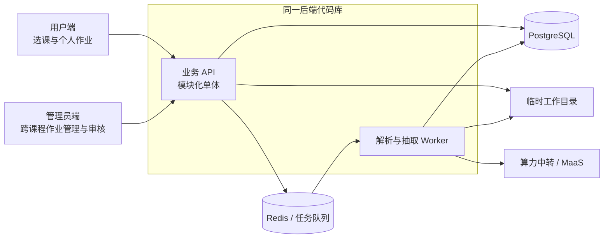
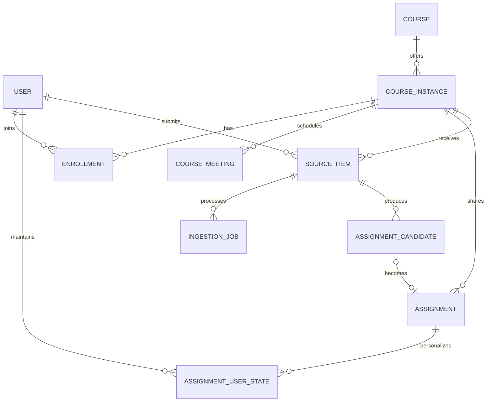
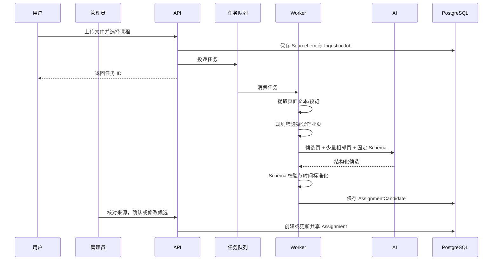

# Homework Canvas 架构设计

> 状态：管理员/用户双端的作业优先入口已落地；真实登录、管理员授予和生产环境鉴权待单独设计。
> 目标阶段：MVP 到早期多人使用  
> 核心原则：业务系统为主，AI 仅承担信息解析与结构化抽取

## 1. 产品目标与边界

Homework Canvas 将老师通过 PPT、PDF 或文字消息发布的作业信息，整理为统一的课程、课表、作业和截止时间视图。

教师不作为系统用户参与发布。普通用户自行选择参与的课程，并可提交老师通知作为待审核来源；全站管理员维护课程和共享作业，审核候选后发布。这里的“发布”表示管理员确认了整理结果，不表示教师直接在系统中确认。

系统需要解决三个核心问题：

1. 将分散、格式不统一的作业信息转为结构化数据；
2. 让同一教学班的学生共享同一份课程与作业数据；
3. 保留来源和人工确认入口，避免 AI 误识别直接变成正式作业。

当前阶段不做：

- 复杂 Section、行政班与教学班的多层映射；
- 完整教务系统、成绩系统和在线提交系统；
- 面向任意文档的通用知识库或对话式 AI；
- 微服务拆分；
- 为每个学生单独保存一份课表或共享作业副本。

## 2. 架构原则

- **模块化单体优先**：业务 API 保持单体部署，通过清晰模块边界降低耦合；文档解析和 AI 抽取放入独立 Worker，避免阻塞请求。
- **双端共用业务能力**：用户端与管理员端使用同一前端项目中的两组页面、同一业务 API 和领域模型；页面分工不造成课程与作业数据副本。
- **作业是核心视图**：两端默认从跨课程的作业任务进入；课程用于归属、筛选和维护共享资料，不能成为查看或处理作业的必经入口。`CourseInstance` 仍是共享数据的归属边界，不等于页面导航的中心。
- **PostgreSQL 是业务事实来源**：课程、选课关系、作业和处理状态以数据库为准；Redis 不保存不可恢复的业务事实。
- **共享数据只存一份**：课程共享作业属于 `CourseInstance`；`Enrollment` 表示用户参与课程，不表示管理员身份；个人计划状态单独保存。
- **课表动态生成**：用户课表由 Enrollment 和课程上课安排实时查询得到，不维护用户课表副本。
- **候选与正式数据分离**：AI 输出先成为待确认候选，经过管理员确认后才写入正式作业。
- **来源可追溯**：正式作业保留来源文件、页码或文字片段，便于纠错。
- **为扩展保留接口，不提前拆服务**：解析器、文件存储、任务队列和 AI 提供方均通过稳定接口接入。

当前技术选型及其复核条件见 [技术选型](technology-selection.md)。总架构不依赖某一种编程语言；首版以 Go 实现是当前工程决策，而非 UniSSO 或部署平台的强制要求。

## 3. 系统总览



两个入口属于同一产品。前端保持一个项目，通过用户端和 `/admin` 两组路由与独立导航呈现不同任务；同一时间只展示当前工作台的导航，管理员可按需切换到用户端处理个人事务。两端都以作业为首要入口：用户处理自己的跨课程作业，管理员处理全站待审核、已发布及已撤回作业；课程管理是辅助入口。作业卡、课程信息和 API 类型等可复用。后端仍按课程、作业、导入等业务模块组织，不按页面入口复制服务。API 和 Worker 使用同一代码库、同一领域模型，分别以不同进程启动。

### 3.1 两端的任务边界

| 用户端 | 管理员端 |
| --- | --- |
| 浏览课程目录，自行加入或退出课程；只在个人视图中汇总已加入课程 | 创建和维护全站课程、课表与共享作业；查看全站课程 |
| 查看作业和课表，维护自己的计划截止时间与完成状态 | 按课程查看来源与待审核候选，修改、接受或拒绝后发布共享作业；修改或撤回已发布作业 |
| 将老师文字通知与附件提交到已加入课程，查看自己的处理进度 | 查看课程成员与处理进度，处理共享内容的纠错 |

管理员也可以使用用户端的个人功能。用户自行加入课程只改变参与关系，不获得共享内容的管理能力。首版课程目录展示名称、学期和教师等必要信息；加入后的课程详情与作业进入个人视图。

页面优先级与数据归属分开：用户端首页优先汇总已加入课程的作业，管理员端默认汇总全站需要审核、修改或撤回的作业。课程筛选和课程详情用于缩小范围或维护课表、成员、来源；不能要求先选课程才能发现待处理作业。

## 4. 核心模块

### 4.1 用户与参与关系

职责：

- 保存用户的全站类型：`admin` 或 `user`；教师姓名只是课程资料，不对应第三种系统角色；
- 维护用户对 CourseInstance 的参与关系，支持自行加入与退出；
- 为个人作业、课表与来源查询提供当前用户和参与课程的上下文。

本轮已实现两个工作台及业务接口，并基于数据库中的全站类型检查管理员操作。当前本地请求头身份适配器仅供开发演示；仅靠 `/admin` 路由、隐藏按钮或可伪造的请求头不能形成生产环境访问控制。真实登录、管理员授予和生产环境鉴权待单独设计接入。

### 4.2 课程模块

职责：

- 维护课程基本信息与具体开课实例；
- 提供课程目录，以及用户自行加入和退出课程的操作；
- 维护用户选课关系；
- 维护每周上课时间、地点及有效日期；
- 根据用户 Enrollment 动态生成课表。

关键概念：

- `Course`：相对稳定的课程定义，例如“软件测试”。
- `CourseInstance`：某学期、某老师实际开设的一门课。
- `Enrollment`：用户加入 CourseInstance 的关系；不承载管理员/普通用户类型。
- `CourseMeeting`：CourseInstance 的周期性上课安排。

暂不设置 Section。未来只有出现同一 CourseInstance 内作业或课表明显分组的需求时，再增加 Section，并让 Enrollment 可选关联 Section。

### 4.3 作业模块

职责：

- 维护课程实例下的共享作业；
- 提供跨课程和单课程的截止时间排序查询；
- 支持管理员确认、修改或拒绝 AI 生成的作业候选；
- 保存作业与原始来源之间的关联。

管理员核对来源后发布的作业内容和老师通知中的截止时间属于 CourseInstance，不属于单个用户。个人计划截止时间、完成状态等个性化信息保存到 `AssignmentUserState`，不复制或修改共享 Assignment。界面应清楚标明截止时间来自老师通知及管理员核对，避免把管理员发布误解为教师直接确认。

#### 前端展示约定

“作业”是整个产品的核心视图。用户端首页和作业页默认展示当前用户已加入课程的全部作业；管理员端默认展示跨课程的审核与共享作业管理任务。两端均可按课程缩小范围，但不要求逐门进入课程后才看到作业。

- 待处理作业按个人有效截止时间升序排列：设置个人计划截止时间时使用该时间，否则使用官方 `due_at`；
- 官方截止时间与个人计划截止时间同时存在时，卡片同时展示，个人计划不修改全班共享作业；
- 已逾期作业依据官方 `due_at` 单独分组并明显标记，避免个人计划时间掩盖真实逾期；
- 无法确定截止时间的作业放在“截止时间待确认”分组，不参与正常时间排序；
- 每项至少显示课程名称、作业标题、简要说明、截止时间和当前状态；有提交地址时提供链接入口；
- 用户进入课程详情后，仍可查看只属于该 CourseInstance 的同样排序列表。

排序由后端查询保证，前端负责分组和展示。这样分页、多个客户端以及后续通知功能使用的是同一套顺序定义。相同截止时间使用 Assignment ID 作为稳定的次级排序键。

### 4.4 来源与导入模块

职责：

- 接收 PPT、PDF 和纯文字消息；
- 将上传文件仅写入 API 与 Worker 可访问的临时工作目录，将元数据与文字消息保存到 PostgreSQL；
- 创建异步处理任务并向用户返回可查询的任务 ID；
- 展示处理进度、失败原因和来源文字证据。

来源在进入系统时必须关联目标 CourseInstance，避免 AI 猜测课程归属。

PPT、PDF、图片和候选页预览不作为产品数据持久化。Worker 在任务完成、失败或超过临时文件保留期后删除它们；正式作业仅保留来源类型、原始文件名、校验值、页码和必要的文字证据。处理完成后如需重新解析原始文档，用户必须重新上传。

### 4.5 文档解析与 AI 抽取模块

职责：

- 从 PPT/PDF 提取页面文本和必要的页面预览；
- 使用规则为每页计算“疑似作业页”分数；
- 将候选页与少量相邻页组成最小上下文；
- 通过算力中转调用 MaaS，要求返回固定结构的 JSON；
- 执行结构校验、时间标准化和结果落库。

该模块只产出 `AssignmentCandidate`，不直接创建正式 Assignment。

## 5. 核心数据模型



建议的最小实体如下：

| 实体 | 关键字段 | 说明 |
| --- | --- | --- |
| User | id, external_subject, name, role, status | 系统用户；目标全站类型为 `admin / user` |
| Course | id, code, name | 稳定课程定义 |
| CourseInstance | id, course_id, term, teacher_name, status | 某学期的具体课程 |
| Enrollment | user_id, course_instance_id, status | 用户与课程实例的唯一参与关系，不决定管理范围 |
| CourseMeeting | course_instance_id, weekday, start_time, end_time, location, valid_from, valid_to | 生成课表的依据 |
| Assignment | course_instance_id, title, description, due_at, status, created_by | 全班共享的正式作业 |
| AssignmentUserState | assignment_id, user_id, personal_due_at, completion_status | 学生个人计划与完成状态，不改变共享作业 |
| SourceItem | course_instance_id, submitted_by, type, original_filename/raw_text, checksum, status | 原始文件或文字来源的元数据；二进制原件不持久化 |
| IngestionJob | source_item_id, stage, status, attempts, error_code, started_at, finished_at | 异步处理记录 |
| AssignmentCandidate | source_item_id, title, description, due_at, evidence, confidence, review_status, reviewed_by | AI 抽取候选及证据 |

关键约束：

- `User.role` 表示全站管理员或普通用户；课程参与关系不改变该类型。现有数据库的 `Enrollment.role` 属于旧实现，迁移时不自动将课程维护者升为全站管理员；
- `Enrollment(user_id, course_instance_id)` 唯一；
- `AssignmentUserState(assignment_id, user_id)` 唯一，`personal_due_at` 为空表示沿用官方截止时间；
- CourseMeeting 只描述课程安排，不生成和保存用户课表行；
- AssignmentCandidate 与 Assignment 分离，`review_status` 至少包括 `pending / accepted / rejected`；
- 所有时间在数据库中使用带时区时间，课程实例保存默认时区；
- 二进制文件不直接存入数据库或对象存储；仅在任务的临时工作目录中存在，数据库保存原始文件名、校验值、状态和抽取后的必要文字证据。

## 6. 作业导入链路

### 6.1 PPT / PDF



规则筛选只负责提高召回并控制 AI 成本，不负责最终判断。首版规则可关注：

- “作业、提交、截止、deadline、due”等关键词；
- 日期、时间、周次与提交平台表达；
- 页面标题和文本密度；
- 同一页同时出现任务动作与时间信息。

候选上下文默认使用命中页及前后各 1 页；具体窗口应可配置，但不做全文默认发送。

### 6.2 纯文字消息

文字消息无需文档预筛选，直接进入固定 Schema 的 AI 抽取，再走相同的校验、候选确认和正式入库流程。

### 6.3 AI 输出边界

AI 输出字段应限制为：

- 作业标题；
- 作业描述；
- 截止时间及其原始表达；
- 提交方式；
- 来源证据片段与页码；
- 字段级置信度；
- 无法确定的字段列表。

不允许 AI 决定课程归属、用户类型或直接发布作业。日期缺少年份、时区或表述冲突时，应标记为不确定并等待管理员确认，不进行静默猜测。

## 7. 状态与失败处理

导入任务采用简单、可恢复的状态机：

`queued -> parsing -> locating -> extracting -> validating -> review_ready -> completed`

任一步骤失败进入 `failed`，记录稳定错误码与可读说明。Worker 只对临时故障自动重试，例如网络超时；格式不支持、文件损坏和结构校验失败不应无限重试。

为避免重复上传或任务重试产生重复结果：

- SourceItem 保存文件或文字内容的校验值；
- 每个处理步骤按 `job_id + stage` 保持幂等；
- 接受候选时使用数据库事务，并保证同一候选最多生成一个 Assignment。

## 8. API 边界

目标 API 按使用场景区分查询与操作，仍调用同一套课程、作业和导入服务；路径只是资源边界示意，不要求为了分端复制领域模型：

- 课程目录与 `/me/course-instances`：分别用于浏览可选课程和查询已加入课程；
- `/course-instances/{id}/enrollment`：当前用户加入或退出课程；
- 管理员课程操作：创建、修改课程实例和上课安排，查看成员；
- `/me/schedule`：根据 Enrollment 动态查询个人课表；
- `/me/assignments`：聚合当前用户所有已选课程的作业，按个人有效截止时间升序返回，并同时返回官方与个人计划截止时间；
- 课程作业查询与管理员共享作业操作：读取可复用，创建和修改集中于管理员端；
- `/assignments/{id}/my-state`：维护当前用户的个人计划截止时间和完成状态；
- `/sources`：用户向已加入课程上传文件或提交文字消息；
- `/ingestion-jobs/{id}`：查询异步任务状态；
- 管理员待审核列表及候选操作：跨课程查看待审事项，再按来源修改、接受或拒绝候选。

模块之间通过应用服务调用，不允许控制器直接跨模块修改数据表。Worker 通过任务载荷中的 ID 读取数据库，不在队列中传输完整文件或大段正文。

作业列表以 `COALESCE(assignment_user_states.personal_due_at, assignments.due_at) ASC NULLS LAST, assignments.id ASC` 作为稳定排序。接口需要返回 CourseInstance 的名称或简要信息，避免前端为列表中的每项作业再次请求课程数据；同时返回官方截止时间，供逾期判断。Assignment 应建立以 `course_instance_id`、`due_at` 为核心的查询索引。

## 9. 部署方案

部署时仍只需一份前端静态资源；用户端与管理员端通过路由进入，不需要两套前端构建。首版可使用 Docker Compose：

- `web`：前端静态资源；
- `api`：业务 API；
- `worker`：文档解析与 AI 抽取；
- `postgres`：业务数据库；
- `redis`：任务队列及短期缓存；
- `ingestion-tmp`：API 与 Worker 可访问的临时工作目录，仅保存正在处理或允许自动重试的上传文件；任务终态后清理。

`api` 与 `worker` 使用同一后端镜像和不同启动命令。生产扩容时，优先独立增加 Worker 数量；只有出现明确的容量、团队或故障隔离需求后，再考虑拆分微服务。

临时目录不是文件存储能力，不承诺重启后保留。首版 API 与 Worker 在同一部署主机上运行；未来若需要多主机、跨节点 Worker 或支持重新查看原件，再单独决策是否引入对象存储。

## 10. 安全与可观测性

当前迭代先明确两端的业务边界，不把页面分端当成鉴权。接入真实身份与对外部署时，需要落实：

- 管理员操作校验全站 `admin` 类型，个人数据校验当前用户和课程参与关系；
- 管理员初始授予采用明确的管理流程，不由创建课程或旧的 `maintainer` 关系自动获得；
- 临时工作目录不作为静态目录暴露；任务结束后的原始文件和预览必须被删除；
- 限制上传文件类型、大小和单任务处理时间；
- 日志携带 `request_id`、`job_id`、`source_item_id`，但不记录完整课件和用户文字；
- 记录任务耗时、失败率、候选接受/修改/拒绝情况；
- AI 密钥只通过环境变量或密钥服务注入。

候选接受率和修改率可衡量抽取效果，但在积累足够样本前，不应据此自动发布作业。

## 11. 建议的代码组织

```text
backend/
  app/
    modules/
      identity/
      courses/
      assignments/
      ingestion/
    workers/
      document_parser/
      candidate_locator/
      ai_extractor/
    shared/
      database/
      temporary_files/
      task_queue/
      ai_provider/
  migrations/
frontend/
  src/
    workspaces/
      user/               # 选课、个人作业、课表和来源提交
      admin/              # 全站课程、审核与共享作业维护
    components/            # 两端复用的领域组件
deploy/
  docker-compose.yml
docs/
  architecture.md
```

每个业务模块内部包含自己的领域模型、应用服务、持久化实现和 API 入口。`shared` 只放跨模块的技术适配器，不放课程或作业业务规则。

前端目录是目标职责示意，不要求一次性搬迁现有页面；先按路由和布局拆分用户端、管理员端，再把复用组件留在公共目录。

## 12. 分阶段落地

### 阶段一：可用闭环

- 课程、开课实例、Enrollment 和 CourseMeeting；
- 动态课表，以及跨课程按个人计划截止时间排序、保留官方截止时间的作业视图；
- 文字消息抽取；
- 候选确认后生成正式作业；
- Docker Compose 本地部署。

### 阶段二：文档导入

- PDF/PPT 页面解析；
- 规则定位候选页；
- 候选页与相邻页的 AI 抽取；
- 来源页预览、失败重试和处理进度。

### 阶段三：多人使用加固

- 更完整的课程维护权限；
- 通知与个人作业状态；
- 基于真实数据优化候选规则和抽取质量；
- 按实际需求评估 Section，而非预先引入。

### 已落地：管理员端与用户端

- 用户端增加课程目录、自主加入和退出；个人作业、课表与来源提交只围绕已加入课程；
- 管理员端集中管理全站课程、课表、共享作业和待审核候选；
- 将旧的课程 `maintainer/student` 关系调整为全站 `admin/user` 类型与独立的课程参与关系；
- 两端业务流程与页面分工已落地；真实登录、管理员授予和生产环境鉴权随后单独设计并接入。早期分设计中的旧角色描述不代表当前能力。

## 13. 关键架构决策

1. **不把 AI 放在核心业务路径中央**：即使 AI 暂时不可用，用户仍可手工创建、查看和管理课程与作业。
2. **正式作业与 AI 候选分离**：保证共享数据的可信度，也保留后续自动化策略的演进空间。
3. **CourseInstance 是共享边界**：课程成员、课表安排和作业围绕同一教学实例组织。
4. **API 与 Worker 逻辑分离、代码复用**：避免长任务阻塞，同时保持单仓库和简单部署。
5. **先保留来源与反馈数据，再优化模型**：后续改进应基于真实误差，而不是提前堆叠复杂 AI 能力。
6. **全站管理员与自主选课分离**：管理员维护共享事实，用户决定自己参与的课程；两个工作台共用同一套业务服务和数据。
