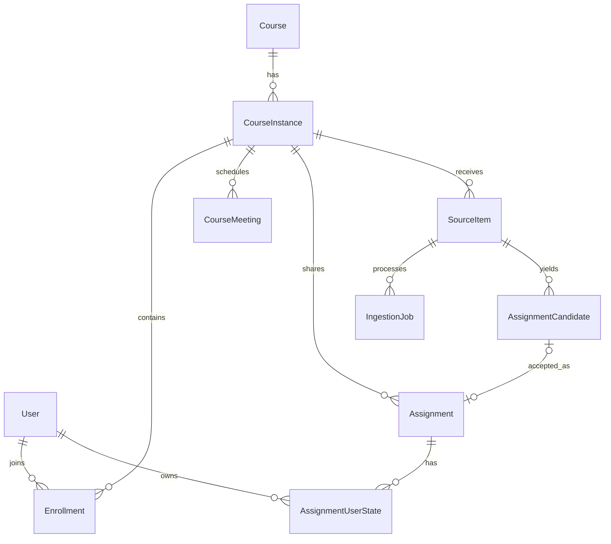
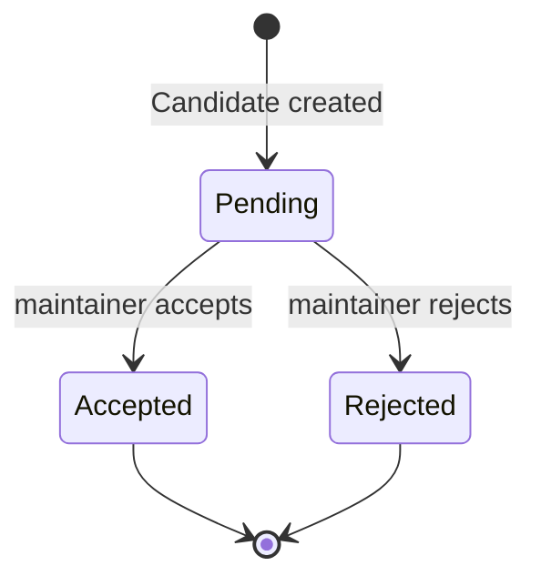
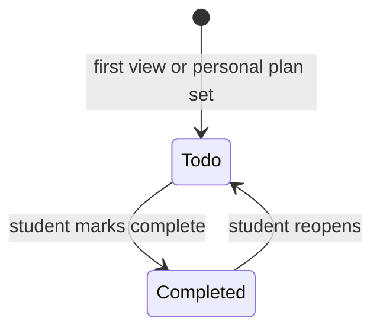

# 领域模型设计

> 参考：[总架构](../architecture.md) · [技术选型](../technology-selection.md)  
> 范围：首版课程、作业、个人 DDL 与导入闭环

## 1. 领域边界

Homework Canvas 有三类事实：

- **课程共享事实**：课程实例、选课关系、上课安排和官方作业；
- **学生个人事实**：个人计划截止时间与完成状态；
- **导入过程事实**：来源、解析任务和 AI 候选。

官方作业只属于 `CourseInstance`。个人 DDL 是学生对官方作业设置的计划时间，不会修改、覆盖或延后全班可见的官方截止时间。



## 2. 核心对象

### User

Canvas 中的用户投影。身份来自 UniSSO；Canvas 只保存稳定外部主体标识、展示信息和本地状态，不维护密码或登录凭据。

### Course 与 CourseInstance

- `Course`：稳定课程定义，如“软件测试”。
- `CourseInstance`：某学期、某位教师实际开设的课程，是成员、课表和共享作业的边界。

首版不建 Section。若未来确有不同分班拥有不同课表或不同作业，再在 `CourseInstance` 内引入它。

### Enrollment

用户加入某个 CourseInstance 的关系。角色仅有：

- `maintainer`：维护课程安排、成员及共享作业；审核 AI 候选；
- `student`：查看课程、维护自己的作业状态，并可提交导入来源。

离开课程使用状态变更，不物理删除 Enrollment，以免破坏历史作业的归属和审计。

### CourseMeeting

CourseInstance 的周期性上课安排。它是课表生成依据，而不是用户课表副本。一个 Meeting 只表达单个星期几、开始结束时间、地点和生效日期范围。

### Assignment

CourseInstance 的共享正式作业。

- `title`、`description`、`submission_method` 为课程共享内容；
- `official_due_at` 为官方截止时间，可为空；
- `status` 首版为 `published` 或 `cancelled`；
- 可选关联一个被接受的 `AssignmentCandidate`，形成可追溯来源。

手工创建作业允许没有候选来源。

### AssignmentUserState

用户与 Assignment 的一对一状态，按需创建。

- `personal_due_at`：个人计划截止时间；为空时个人有效截止时间使用官方截止时间；
- `completion_status`：`todo` 或 `completed`；
- `completed_at`：完成时记录。

个人有效截止时间为：

```text
effective_due_at = personal_due_at ?? official_due_at
```

列表可按 `effective_due_at` 排序，但“官方逾期”始终只按 `official_due_at` 判断。若两者均存在，前端必须同时展示，避免学生把个人计划误认为教师要求。

### SourceItem

一次文字消息或文件上传的来源记录，必须先绑定 CourseInstance。

- 文字消息保存原文；
- 文件只保存文件名、MIME、大小、校验值等元数据；
- PPT、PDF、图片及页面预览只在任务临时目录存在，任务结束后删除。

来源记录保存必要文字证据与页码，但不承诺可以重新打开原文件。

### IngestionJob

一次来源的异步处理记录。它描述“处理到了哪一步、是否可重试、失败原因是什么”，不承载业务作业内容。

### AssignmentCandidate

AI 从 SourceItem 中抽取出的待审核作业。其内容包含标题、描述、官方截止时间、提交方式、证据页码与文字片段、字段置信度和不确定字段。

候选状态：

- `pending`：等待维护者审核；
- `accepted`：已经生成或更新一个共享 Assignment；
- `rejected`：确认不是作业或不采用。

候选被接受时，维护者可修改字段；最终 Assignment 才是对学生可见的事实。

## 3. 关键业务规则

1. 只有有效 Enrollment 的用户可以读取对应课程的数据。
2. 只有 maintainer 能维护共享作业、课程安排、成员和候选审核结果。
3. student 只能修改自己的 AssignmentUserState，不能修改 Assignment 的官方截止时间。
4. 每个用户对同一 Assignment 最多有一条 AssignmentUserState。
5. 同一候选最多被接受一次，并最多对应一个 Assignment。
6. 任何文件来源都必须在上传时指定 CourseInstance，AI 不负责猜测课程归属。
7. AI 不能直接发布作业；没有审核动作，Candidate 不进入学生作业列表。

## 4. 生命周期





## 5. 首版刻意不建的对象

- Section、行政班和教学班映射；
- 用户独立于课程作业之外的任意待办事项；
- 作业提交件、评分、教师批注；
- 原始文档、图片和候选页预览的持久化版本库；
- 自动发布候选作业。
