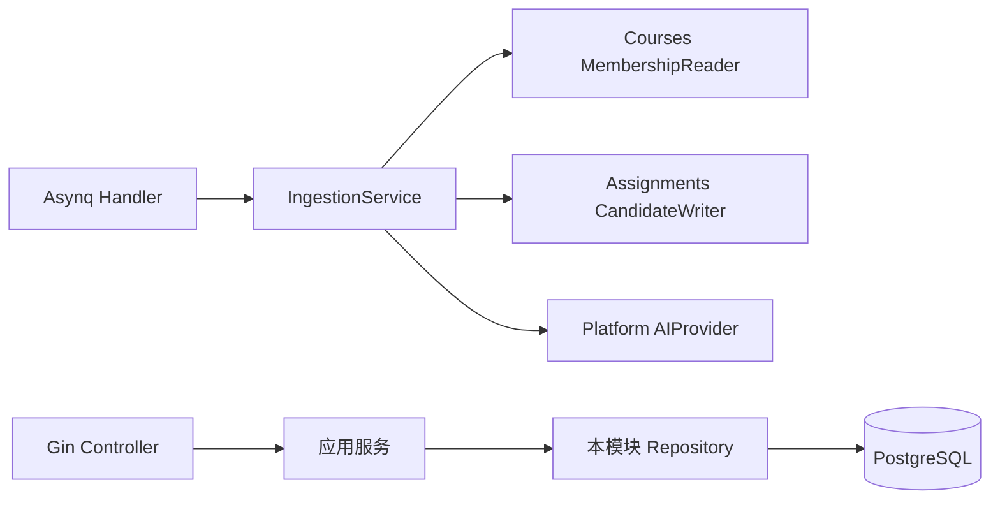

# 后端模块与接口设计

> 参考：[领域模型](01-domain-model.md) · [数据库表设计](02-database-schema.md) · [技术选型](../technology-selection.md)

## 1. 模块划分

```text
backend/
  cmd/api/                 # Gin HTTP 进程
  cmd/worker/              # Asynq Worker 进程
  internal/
    identity/
    courses/
    assignments/
    ingestion/
    platform/              # UniSSO、算力中转适配器
    shared/                # 数据库、事务、错误、时钟、临时目录、任务队列
```

每个业务模块内部按 `domain / service / repository / transport` 组织。`transport` 只存在于 API 模块入口；Worker 直接调用 service，不复用 HTTP Controller。

## 2. 模块职责

| 模块 | 负责 | 不负责 |
| --- | --- | --- |
| identity | 解析 UniSSO 身份、同步 User 投影、当前用户上下文 | 密码、登录页、权限系统重造 |
| courses | Course、CourseInstance、Enrollment、CourseMeeting、课表查询 | 作业内容和 AI 任务 |
| assignments | Assignment、AssignmentUserState、Candidate 审核、作业列表 | 文件转换和 MaaS 调用 |
| ingestion | SourceItem、Job、临时文件、解析、筛页、抽取编排 | 发布正式作业 |
| platform | UniSSO 验签、算力中转客户端 | 课程领域规则 |
| shared | GORM 连接、事务包装、Asynq、临时目录、统一错误 | 任何课程/作业业务判断 |

## 3. 服务接口

接口只在存在跨模块依赖时定义，避免为每个实体提前造抽象。

```go
// courses 对外提供的最小读取能力
type MembershipReader interface {
    RequireActiveMember(ctx context.Context, userID, courseInstanceID uuid.UUID) error
    RequireMaintainer(ctx context.Context, userID, courseInstanceID uuid.UUID) error
}

// assignments 供 ingestion 写入候选
type CandidateWriter interface {
    ReplacePendingCandidates(ctx context.Context, sourceID uuid.UUID, items []CandidateInput) error
}

// platform 层供 ingestion 调用
type AIProvider interface {
    ExtractAssignments(ctx context.Context, input ExtractionInput) (ExtractionResult, error)
}
```

典型应用服务：

- `CourseService.CreateInstance / AddEnrollment / UpdateMeetings / ListMySchedule`
- `AssignmentService.ListMine / UpdateMyState / CreateManual / AcceptCandidate / RejectCandidate`
- `IngestionService.CreateTextSource / CreateFileSource / GetJob / ProcessJob`

Service 输入是普通 Go struct，返回领域结果或统一错误；不接收 `gin.Context`、HTTP DTO 或 Asynq task 对象。

## 4. 调用方向



- API Controller 只能调用应用服务，不能跨模块直接操作 GORM Model。
- assignments 通过 `MembershipReader` 做课程权限判断，避免反向依赖 courses 的 Repository。
- ingestion 只创建 Candidate，不创建 Assignment；Candidate 的发布决策留给 assignments。
- GORM Repository 仅封装本模块表的读写；跨模块事务由拥有该业务动作的 Service 发起。

## 5. API 与 Worker 的边界

| 进程 | 同步工作 | 不做的事 |
| --- | --- | --- |
| API | 鉴权、参数校验、课程/作业查询、建立来源和任务、个人 DDL 修改 | 文档转换、页面渲染、MaaS 调用 |
| Worker | 解析临时文件、规则筛页、调用 MaaS、保存 Candidate、清理临时文件 | 直接回复 HTTP、直接发布 Assignment |

API 创建文件来源后，只向队列传 `job_id`。Worker 根据 job_id 读取数据库和临时目录，不把文件字节或整份课件放进 Redis。

## 6. GORM 使用边界

GORM 用于模型定义、普通查询、分页和 CRUD。以下规则不得交给自动关联、级联保存或隐式预加载：

- Enrollment 权限判断；
- Candidate 接受并发布 Assignment；
- 个人状态只能由本人修改；
- Job 状态流转与候选结果替换。

这些规则在 Service 中以显式查询和数据库事务实现。迁移只由 goose 执行，不使用 GORM AutoMigrate 管理生产 Schema。

## 7. 统一错误

业务层返回结构化错误：`code`、`message`、`details`。HTTP 层负责映射状态码；Worker 将错误码写入 IngestionJob。

首版错误码按模块命名，例如：

- `identity.unauthenticated`、`identity.disabled`；
- `courses.not_member`、`courses.not_maintainer`、`courses.enrollment_exists`；
- `assignments.not_found`、`assignments.candidate_not_pending`；
- `ingestion.unsupported_file`、`ingestion.file_expired`、`ingestion.ai_unavailable`。
