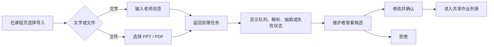

# 前端信息架构与页面流程

> 参考：[总架构](../architecture.md) · [API 设计](04-api-design.md)  
> 前端：Vue 3 + TypeScript；核心任务是展示和管理课程、课表、作业与候选，不把 AI 当作独立产品入口。

## 1. 导航结构

```text
首页
├─ 我的作业
├─ 我的课表
└─ 课程
   └─ 课程详情
      ├─ 作业
      ├─ 课表
      ├─ 来源导入
      └─ 候选审核（仅 maintainer）
```

首页不是聊天页。它首先回答“我最近要做什么、什么时候上课”。

## 2. 首页

首页按信息优先级排列：

1. **临近个人 DDL**：取 `bucket=upcoming`，按 `effective_due_at` 升序；
2. **官方已逾期**：单独展示，不因个人 DDL 被隐藏；
3. **今天/最近课表**：来自 `/me/schedule`；
4. **截止时间待确认**：官方截止时间为空的作业。

作业卡片必须显示：课程名、标题、官方截止时间、个人计划截止时间（若已设置）和完成状态。官方时间与个人时间使用不同标签；不能只展示个人时间。

## 3. 我的作业页

顶部提供：`逾期 / 即将截止 / 待确认 / 全部` 分段筛选，以及课程筛选。默认进入“即将截止”。

分页由 `next_cursor` 驱动，前端不自行重排跨页数据。用户修改个人 DDL 或完成状态后，刷新对应 bucket；若该作业跨越分组，卡片从当前分组移除并出现在新分组。

个人 DDL 编辑为日期时间输入与“恢复官方截止时间”操作：

- 官方 DDL 存在时，默认带入显示但不写入 personal_due_at；
- 保存个人计划只调用 `PUT /assignments/{id}/my-state`；
- 标记完成也只修改个人状态，不影响其他学生。

## 4. 课程页与课程详情

### 课程列表

展示用户有效 Enrollment 的 CourseInstance：名称、学期、教师、下一个 Meeting、未完成作业数量。无权课程不出现在列表中。

### 课程详情

页签为：

- **作业**：本课程共享作业，仍按当前用户个人有效截止时间排序；
- **课表**：CourseMeeting 的课程视图；
- **来源导入**：文字输入与文件上传，展示自己的任务；maintainer 可见全部任务；
- **候选审核**：仅 maintainer 可见，展示 pending Candidate。

maintainer 额外看到课程信息、成员和 Meeting 的编辑入口。student 不显示不可执行的管理按钮。

## 5. 导入与候选审核流程



上传完成后页面立即返回 Job 卡片，不等待 AI。失败时显示可读原因和“重新上传”入口。由于原始文件和页面预览不持久化，任务结束后的候选审核只展示来源文件名、页码与文字证据，不提供原页回看。

确认候选时，维护者看到可编辑的标题、说明、官方截止时间和提交方式；不确定字段必须显式显示，不能默默填充默认值。

## 6. 页面状态与权限反馈

| 场景 | 页面行为 |
| --- | --- |
| 未登录/UniSSO 失效 | 跳转主站登录或显示统一登录提示 |
| 非成员访问课程 | 显示无访问权限，不泄露课程内容 |
| student 访问审核页 | 隐藏入口；直达链接返回权限提示 |
| 文件正在处理 | 禁用重复确认，不阻塞浏览课程和作业 |
| Job failed | 展示错误说明和重新上传，不显示技术栈细节 |
| 官方 DDL 缺失 | 归入待确认，不伪造日期 |

## 7. 首版不做的前端能力

- 原始课件、候选页图片的历史浏览；
- 拖拽日历、复杂日程同步；
- 作业提交、评分、评论；
- 学生之间的任务分配或共享个人 DDL；
- 对话式 AI 助手入口。
