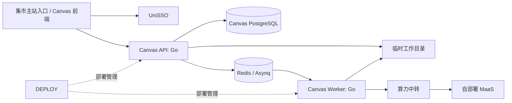

# Homework Canvas 技术选型

> 状态：首版决策  
> 范围：MVP 到接入 SSE Market 的早期多人使用阶段

## 1. 决策结论

首版后端采用 **Go**。它以独立 Docker 服务接入 SSE Market，通过既有协议使用 UniSSO、DEPLOY 和算力中转；不复制主站账号体系，也不直接管理 MaaS 或 GPU。

这一选择不是因为 Go 是唯一可部署语言，也不是因为本产品当前需要极高吞吐。已有非 Go 服务可以接入平台，说明服务边界是语言无关的。Go 是为了让 Canvas 的业务 API、异步 Worker 和后续长期维护使用同一套后端语言与工程方式。

## 2. 选择的技术组合

| 范围 | 选型 | 用途与边界 |
| --- | --- | --- |
| HTTP API | Go + Gin | 提供课程、Enrollment、动态课表、作业与导入任务接口；保持 REST 风格。 |
| 领域与持久化 | Go + GORM | 使用模型和常规 CRUD 加快课程、作业等业务开发；关键跨实体流程不依赖自动关联保存或级联更新。 |
| 数据库迁移 | `goose` | 版本化管理 PostgreSQL Schema。 |
| 异步任务 | `asynq` + Redis | 投递和执行解析、转换、候选页定位、MaaS 抽取任务；任务事实状态仍存 PostgreSQL。 |
| 上传文件 | 临时工作目录 | PPT、PDF、图片和页面预览只在解析期间保留；任务终态后删除，不建设对象存储。 |
| 文档标准化 | LibreOffice Headless + Poppler | PPT/PPTX 转 PDF，再提取逐页文本和预览图；PDF 直接进入 Poppler 流程。 |
| AI 提供方 | `AIProvider` 适配层 + 算力中转 | Worker 调用平台 MaaS，接收受 Schema 约束的作业候选；浏览器不直接调用。 |
| 容器部署 | Docker 镜像 + DEPLOY | API 和 Worker 使用同一 Go 代码库、不同启动命令；文档工具只装在 Worker 镜像。 |

前端保持 Vue 3 + TypeScript。它通过 REST API 使用 Canvas，不与 Go 共享运行时。

Gin 只负责路由、中间件、请求绑定和响应序列化。Controller 将请求转换为应用层输入，课程、作业、权限和导入等业务服务不依赖 `gin.Context`；这样后续替换 HTTP 框架或增加 Worker 入口时不影响领域逻辑。

## 3. 服务接入边界



- **身份**：Canvas 消费 UniSSO 已验证的用户身份，只保存外部用户 ID，不保存密码或登录会话的业务副本。
- **数据**：课程、Enrollment、作业、个人作业状态、来源元数据和任务是 Canvas 的专属数据。即使使用同一 PostgreSQL 集群，也应使用独立数据库或 schema、角色和迁移记录；原始上传文件和页面预览不持久化。
- **AI**：Canvas Worker 只访问算力中转定义的接口；模型地址、GPU、模型密钥、排队和限流不属于 Canvas。
- **部署**：DEPLOY 面向容器和健康检查，而非特定语言运行时；Go 是本服务的实现选择，不是平台协议。

## 4. 文档处理策略

首版不依赖 Go 的 PPT/PDF 原生解析库，而是将格式处理统一为可审计的页面产物：

```text
PPT / PPTX -> LibreOffice 转 PDF -> Poppler 提取每页文本与预览
PDF        -> Poppler 提取每页文本与预览
文字消息   -> 直接进入结构化抽取
```

这样规则定位和 AI 抽取在任务执行期间面对统一输入：`页码 + 页面文本 + 页面预览`。它支持旧 `.ppt`，也让“候选页及其相邻页”能以老师实际展示的页面形式送入 MaaS；任务完成后仅保留页码和必要文字证据。

Worker 需要为 LibreOffice 设置超时、内存限制和低并发上限；转换失败必须返回可读状态，不自动伪造文本或页码。容器内还要提供稳定的中文字体，否则页面布局可能与教师机器不同。

## 5. 为什么先选 Go，而不是 Python

Python 的 `python-pptx`、PyMuPDF 和 OCR 生态在直接读取 PPTX 结构、处理扫描件和快速补救异常文档时更便利。若首版目标是只支持 `.pptx`、直接抽取文本且短期不接入平台，Python 是更快的路径。

本项目先选 Go 的前提是：首版已接受 LibreOffice + Poppler 作为统一的文档标准化层。此时主要业务是课程、选课、截止时间排序、任务状态和平台集成；PPT/PDF 原生库差异不再是核心路径的决定因素。Go 也能以同一代码库运行 API 与 Worker，减少业务语言切换。持久化层先采用 GORM 提高交付速度，并由数据库迁移和服务层约束关键关系。

性能不是本次决定的主理由：

- 课程和作业查询的瓶颈主要是 PostgreSQL 的索引、分页和连接池；
- 文件转换受 LibreOffice、Poppler、CPU 和内存限制；
- AI 抽取受 MaaS 的模型队列、GPU 与网络延迟影响；
- Go 在高并发 API 和 Worker 调度上通常更节省常驻资源，但不应在没有实际负载数据前宣称产品性能收益。

## 6. 现在不选的方案

- **Python + FastAPI + Celery**：不是不可用，而是当前不作为首版实现语言。保留为文档处理出现明确缺口时的候选方案。
- **Go API + Python Worker**：首版不采用。它会增加两套代码、镜像和消息契约；只有 OCR 或复杂版面解析证明 Go/外部工具方案不足时再引入。
- **用 ORM 自动关联编排关键业务**：不采用。GORM 用于模型和常规读写；作业发布、候选接受、Enrollment 权限检查等流程必须在应用服务和数据库事务中明确组织。
- **直接把 PPT/PDF 全文交给 MaaS**：不采用。必须先规则定位候选页和有限相邻页，控制成本、延迟和隐私暴露范围。
- **直接访问 MaaS**：不采用。必须经由平台算力中转，复用模型访问控制、审计与资源调度。

## 7. 复核条件

以下情况出现时，重新评估文档处理语言与实现，但不影响课程、作业和 Enrollment 的领域模型：

1. LibreOffice 转换后的中文字体、页面布局或文本顺序频繁影响候选页判断；
2. 扫描 PDF、图片作业通知成为常见来源，且需要 OCR；
3. PPTX 中的图表、SmartArt、备注或嵌入对象包含关键作业信息；
4. 转换 Worker 的实际资源占用成为可观测的系统瓶颈；
5. 平台提供了更合适且经过验证的文档解析能力。

6. 需要多个 API 副本、跨主机 Worker、多机部署，或出现重新查看原件的明确需求。

在上述证据出现前，不预先增加 Python Worker、对象存储、向量数据库或复杂文档智能体。
