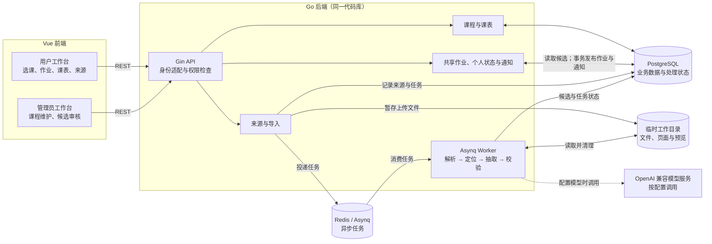

# Homework Canvas 项目架构图

本图对应当前实现：用户端与管理员端共用 Vue 前端项目和 Gin API；API 与 Worker 属于同一 Go 代码库，分别运行。PostgreSQL 保存业务数据，Redis / Asynq 承载异步任务。

抽取结果先保存为待审核候选。管理员可以修改、接受或拒绝候选；接受时才在同一数据库事务中创建正式共享作业和站内通知。未配置模型时，Worker 使用本地规则抽取器。上传文件、逐页文本和预览仅在处理期间存放于临时目录。

当前身份适配器使用本地开发请求头；真实登录与生产环境鉴权尚未接入。
